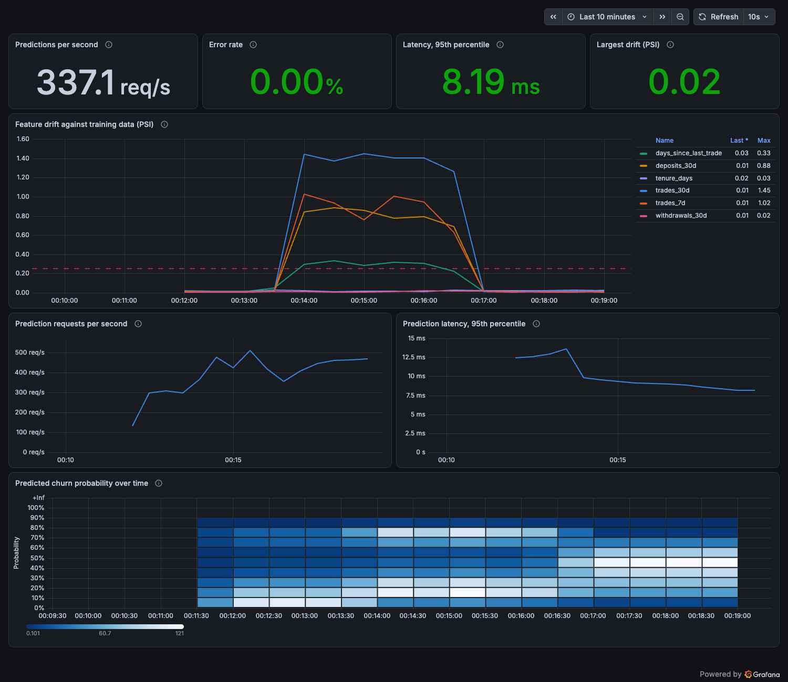
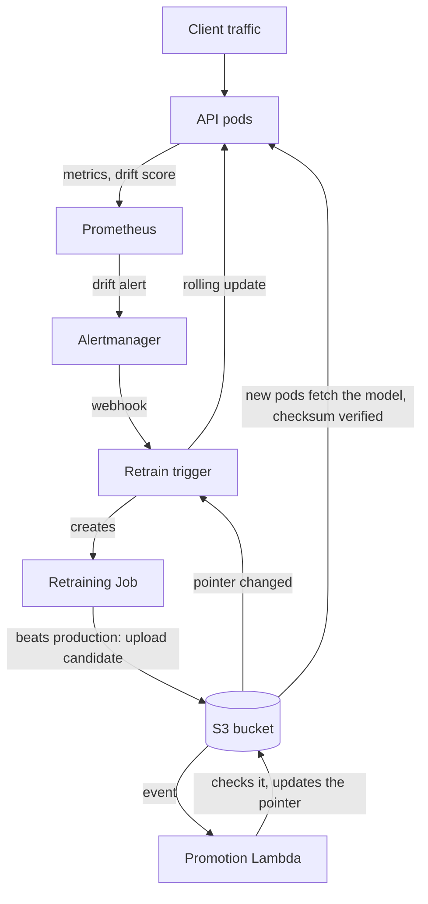

# Trader Churn MLOps

[](https://github.com/VrachasotakiOlga/trader-churn-mlops/actions/workflows/ci.yml)

A churn prediction model for a trading broker, wrapped in the system that keeps it working:
it detects when client behaviour changes, retrains, proves the new model is better, and rolls
it out with no downtime and no human action.

> **Scope:** this runs on Kubernetes (minikube locally, kind in CI) and on
> [MiniStack](https://ministack.org/), a local AWS emulator. It hasn't been deployed to real AWS.
> The data is synthetic. [Limits](#limits) lists what that does and doesn't prove.



## How it works



1. The API compares recent requests with the training data, using the Population Stability
   Index (PSI).
2. If a feature stays above 0.25 for a minute, Prometheus fires an alert, which goes to a small
   controller.
3. The controller starts a retraining Job. A new model must beat the production model on the
   same new data, or it's rejected and production doesn't change.
4. A passing model is uploaded to S3, which runs a Lambda. The Lambda checks the gate result and
   checksums, then updates the pointer that names the production model.
5. The controller sees the pointer change and starts a rolling update. New pods download the
   model and refuse it if a checksum doesn't match.

## What was measured

**The full loop on minikube, with only drifted traffic as input:**

| Time | Event |
|---|---|
| 0:31 | Drift score jumps to 1.41, alerts pending |
| 1:32 | Alerts firing |
| 2:03 | New model promoted, ROC AUC 0.694 against production's 0.553 on the same new data |
| 3:35 | New model rolled out, drift score back to 0.02 |
| 4:05 | Alerts cleared |

**0 of 214,832 requests failed**, with 3 parallel workers.

I then deleted everything and rebuilt it by following [Run it](#run-it). The loop worked again:
the new model scored 0.672 against production's 0.552, 0 of 189,260 requests failed, and no pod
restarted. The screenshot above is from that run. The failure tests below ran on the earlier
cluster.

| Failure tested | Result |
|---|---|
| Model file replaced with junk in S3 | Checksum refused it, the rollout stopped, and the old pods kept serving |
| Retrained model not clearly better (0.671 against 0.664) | Rejected, production unchanged |
| A pod killed, plus a full rolling restart, under load | 0 of 106,336 requests failed |
| Rollback | One command, and the controller noticed within about 10 seconds |
| Pod without the access label calling the API | Blocked by NetworkPolicy |
| Pod that breaks the `restricted` security standard | Refused by the cluster |
| API pod connecting to the internet | Blocked. It can only reach the model store |

## Problems found by testing

- **Requests failed during rolling updates (0.18%), though every readiness check was correct.**
  A stopping pod can still receive traffic for a moment. A 5-second `preStop` pause fixed it.
- **The first full loop worked, but failed 31,650 of about 141,000 requests.** minikube reports 8
  CPUs to Kubernetes but is limited to 4, so the cluster overcommitted, and its own API server and
  DNS ran out of CPU. Limits that fit the real capacity fixed it.
- **Grafana used 3.4 CPU cores while stuck at its memory limit**, starving everything on the node.
  More memory fixed the cause, and a CPU limit keeps it from happening to the API again.
- **A fixed quality gate would have rejected better models.** After drift, the best achievable score
  falls from about 0.83 to about 0.68, so the gate now compares models on the same new data.

## Design decisions

| Decision | Why | Trade-off |
|---|---|---|
| Production is a pointer file in S3 | Promoting and rolling back change one small file, all at once | Needs a controller to act on it |
| Reconcile loop rather than reacting to events | Survives restarts, and manual rollbacks need no extra code | Up to 15 seconds of delay |
| Separate API and training images | The API image doesn't include MLflow | Two images to build |
| Model downloaded at startup, not in the image | A new model doesn't need a new image | Pods depend on S3 when starting |
| Training can't promote its own model | A bug in training can't change production directly | One more component |
| Drift measured on inputs | Real outcomes arrive weeks later | Can miss changes that leave inputs unchanged |
| Rolling update rather than a canary | Much simpler, and readiness checks catch broken models | No live traffic comparison |

## Stack

| Area | Tools |
|---|---|
| Model and tracking | scikit-learn, MLflow |
| Serving | FastAPI, Docker |
| Orchestration | Kubernetes, Helm |
| Infrastructure as code | Terraform |
| AWS services (emulated) | S3, Lambda, IAM, KMS, CloudWatch, SNS |
| Monitoring | Prometheus, Alertmanager, Grafana |
| CI/CD | GitHub Actions |

Every push runs the tests, trains and gates a model, builds and tests the Docker image, then
creates a temporary Kubernetes cluster, deploys everything, and tests the retraining loop.

## Run it

You need Docker, [uv](https://docs.astral.sh/uv/), [minikube](https://minikube.sigs.k8s.io/),
[Helm](https://helm.sh/), [Terraform](https://developer.hashicorp.com/terraform) and kubectl. It
runs entirely on your machine, needs no AWS account, and costs nothing. Give Docker at least
4 CPUs and 6 GB of memory.

```bash
minikube start -p trader-churn --cni=calico --cpus=4 --memory=4g --addons=metrics-server
scripts/install_monitoring.sh
scripts/deploy_minikube.sh
helm test trader-churn --kube-context trader-churn -n trader-churn --logs
```

See the loop happen by sending drifted traffic. Then watch the Jobs and pods in a second terminal:

```bash
scripts/load_test_minikube.sh 300 3 1.0
kubectl --context trader-churn -n trader-churn get jobs,pods --watch
```

Open the dashboard at http://localhost:3000, logging in as `admin`:

```bash
kubectl --context trader-churn -n monitoring get secret monitoring-grafana \
  -o jsonpath='{.data.admin-password}' | base64 -d; echo
kubectl --context trader-churn -n monitoring port-forward svc/monitoring-grafana 3000:80
```

Go back to the previous model:

```bash
AWS_ENDPOINT_URL=http://127.0.0.1:14566 AWS_ACCESS_KEY_ID=test AWS_SECRET_ACCESS_KEY=test \
  AWS_DEFAULT_REGION=us-east-1 uv run python -m churn.storage \
  --bucket trader-churn-models --rollback
```

Delete everything when you're done:

```bash
scripts/teardown.sh
```

### Without Kubernetes

```bash
uv sync
uv run pytest
uv run python -m churn.data
uv run python -m churn.train
uv run mlflow ui --backend-store-uri sqlite:///mlflow.db
```

## Limits

- **Not real AWS.** MiniStack runs the S3 events, Lambda and Terraform, but doesn't enforce IAM
  permissions or the TLS-only bucket policy, so those are written but unproven. Moving to real AWS
  would also need EKS, ECR and IAM roles for pods (IRSA), rather than the emulator's dummy keys.
  On a new emulator, the first `terraform apply` leaves tags missing from the alarm and SNS topic.
  A second apply clears the difference.
- **Synthetic data.** Drift is simulated, and retraining generates new data rather than loading
  recent clients with known outcomes. With real data, those outcomes would arrive weeks later.
- **The API has no authentication.** It's only reachable inside the cluster, by approved pods.
- **The alert clearing isn't proof of a good model.** New pods compare traffic against the new
  training data. The comparison on new data is the actual evidence.
- **Checksums live in the same bucket as the models.** They catch corrupted or swapped files, but
  not someone who can also rewrite the pointer. Signing would be stronger.
- **Fully automatic retraining is a risky default.** With real clients, I'd add human approval and
  bias checks.
- **MLflow history inside the cluster is discarded with each Job,** because there's no shared
  MLflow server.
- **The load tests show the mechanisms work.** They aren't a capacity measurement.

The project uses GitHub Actions. The same pipeline concepts would carry over to GitLab CI, but the
configuration would need rewriting.
